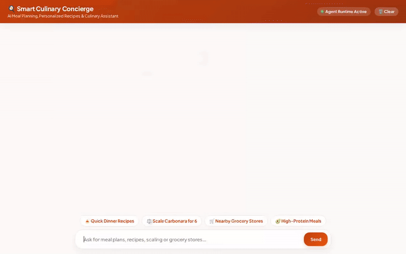

# Smart Culinary Concierge 🧑‍🍳

An intelligent, multi-modal AI culinary assistant built with Google's **Agent Development Kit (ADK)** and powered by **Gemini**. Smart Culinary Concierge helps users discover recipes, personalize meals based on dietary preferences and allergies, scale ingredient quantities, find nearby grocery stores or restaurants, and generate video demonstrations of dishes using Google's Omni model.



---

## 🌟 Capabilities & Features

Based on the actual codebase in `app/`, Smart Culinary Concierge implements the following features:

- **Allergy & Preference Tracking Across Sessions**: Remembers user allergies (e.g., peanuts, gluten, dairy, shellfish) and dietary preferences across conversations using Vertex AI Memory Bank.
- **Recipe Search & Discovery**: Searches local recipe collections in Firestore by cuisine, dietary tags (`vegetarian`, `vegan`, `gluten-free`), cooking time, or ingredient keywords.
- **Recipe Management & Scaling**: Retrieves detailed cooking instructions from Firestore, saves new recipes, and dynamically scales ingredient quantities for target serving sizes.
- **Global Recipe Lookup**: Connects to external global recipe APIs (TheMealDB) for international dish ideas and instructions.
- **Location & Grocery Finder**: Uses Google Maps Geocoding and Places API to locate nearby supermarkets, grocery stores, bakeries, or restaurants based on address or coordinates.
- **AI Video Generation**: Uses Google's Omni model (`gemini-omni-flash-preview`) to generate high-quality cooking videos, saves them as ADK artifacts, and publishes them to Google Cloud Storage.
- **Rich A2UI UI Cards**: Generates structured A2UI display cards (cards, columns, rows, images, and video players) for an interactive UI experience.
- **Code Execution Sandbox**: Equipped with Vertex AI Agent Engine Sandbox Code Executor for safe code execution.

---

## ☁️ Google Cloud Services & Technologies Used

- **Google Agent Development Kit (ADK)**: Core agent framework and A2A orchestration (`acli_version: 1.1.0`).
- **Google Gemini Models**:
  - `gemini-flash-latest`: Core reasoning and multi-modal conversation.
  - `gemini-omni-flash-preview` (Global Region): High-fidelity video generation.
- **Vertex AI Memory Bank**: Long-term conversational memory and profile retention across sessions.
- **Google Cloud Firestore**: NoSQL database backing the `recipes` collection.
- **Google Cloud Storage (GCS)**: Public media bucket hosting generated video assets.
- **Google Maps & Places API**: Geocoding and nearby place discovery (`v1/places:searchNearby`).
- **Vertex AI Agent Engine**: Managed Agent Runtime deployment target (`us-east1`).
- **A2UI Schema Manager (v0.8)**: Generates structured, responsive UI surfaces rendered natively in the chat frontend.

---

## 🛠️ Repository Structure

```
smart-culinary-concierge/
├── app/
│   ├── agent.py          # ADK agent definition, memory callbacks, and tool registrations
│   ├── tools.py          # Implementation of Firestore, Maps, GCS, and Omni video generation tools
│   └── a2ui_utils.py     # Callback transformer for A2UI schema v0.8 payloads
├── frontend/             # FastAPI chat proxy and custom branded UI frontend
├── seed_firestore.py     # Database seeding script for Firestore recipe collection
├── agents-cli-manifest.yaml # Agent Engine manifest configuration
├── pyproject.toml        # Dependencies and project metadata
└── demo.gif              # Inline animated walkthrough demo
```

---

## 🚀 Local Setup & Running Instructions

### Prerequisites

- **Python 3.11+**
- **uv** or **pip**
- **gcloud CLI** authenticated to Google Cloud with necessary permissions (`roles/aiplatform.user`, Firestore access, Cloud Storage access)

### 1. Environment Setup & Configuration

Clone the repository and set up environment variables in a `.env` file:

```bash
cp .env.example .env
```

Ensure your `.env` contains:

```bash
GOOGLE_CLOUD_PROJECT="your-gcp-project-id"
GOOGLE_CLOUD_LOCATION="us-east1"
GOOGLE_MAPS_API_KEY="<your_api_key>"
```

### 2. Install Dependencies

Install required Python packages:

```bash
pip install -r requirements.txt
```

*(Or using `uv`: `uv pip install -r requirements.txt`)*

### 3. Seed Firestore Database (Optional)

Populate your Firestore instance with sample recipes:

```bash
python seed_firestore.py
```

### 4. Run the Agent & Local Chat UI

To run the agent with the local FastAPI proxy and custom chat UI:

```bash
export AGENT_ENGINE_RESOURCE_NAME="projects/<project-number>/locations/us-east1/reasoningEngines/<engine-id>"
export AGENT_DIRECTORY="app"
python main.py
```

Then open your browser to `http://localhost:8080/` to interact with the Smart Culinary Concierge interface.
